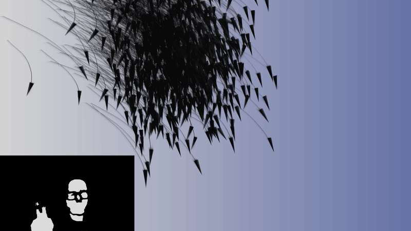
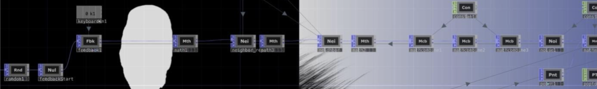

# **MyShikigami**  


**directing flock by gesture** TouchDesigner, MediaPipe 




_Figure 1. from video demonstration_ 

## **Motivation** 

In anime, summoning is one of the most recognizable mechanics. In _Naruto,_ ninjas can form contracts with creatures and complete sequences of the hand ( _Kuchiyose no Jutsu)_ to call them into the fray; in _Jujutsu Kaisen_ , Megumi Fushiguro's Ten Shadows Technique summons familiars out of the shadow by shaping specific hand signs. Both draw on the older Japanese idea of the _shikigami_ from onmyōdō folklore: spirits bound to and commanded by a practitioner. 

To me, it represents a relationship with nature driven by contract, guidance, and mutual respect rather than domination. Stand in front of a webcam, raise your hand, and a swarm of familiar answers. A summoned familiar has a will of its own, but follows its shepherd's intent out of respect. This rendition of the Reynolds' Boids model adds _intent_ to the equation, and lets the local rules decide how that intent ripples through the swarm. 

## **Design & Implementation** 

A camera feeds MediaPipe and hand landmarks are shaped into smooth control signals with CHOPs; those signals become a vector inside a POP feedback loop that implements Boids on the GPU; the result is an instanced, rendered and composited flock. The Point Generator & Random POPs seed points `P` , giving each random velocity _`N`_ . The Feedback POP passes the last frame's data `P` and `N` back in the loop. Three Neighbor POPs do flock sensing, choosing neighbors within a given radius `.` Variables `neighbor_attract` & `neighbor_repel` use position to drive cohesion and separation, while `neighbor_align` takes a distance-weighted average of neighbour velocities. Math Combine POPs then turn those into forces: 

```
cohesion    N += 0.02 · (AttractP − P)        # steer toward neighbours' centre
separation  N −= repel_force · (RepelP − P)   # push away from crowding
alignment   N += 0.02 · (AlignN − N)          # match neighbours' heading
turbulence  N += noise(P) · 0.08              # Noise POP, organic wobble
steering    N += 0.2 · FingerP · h            # hand intent (gesture)
centering   N −= 0.001 · P · (1 − h)          # recall when no hand
integrate   P += 0.05 · N                     # step
```

All weights come from Constant CHOPs ( `constant1–6` ). A Copy POP instances a 3-sided Tube POP (cone/arrowhead) on every point, oriented along `N` ; a Trail POP draws each boid's recent path. A POP to CHOP plus Analyze CHOPs measure the flock's centroid and spread, and the camera's translate parameters follow them, so the view glides with the swarm. 




_Figure 2. The POP feedback chain in the network_ 

MediaPipe's `hand_tracking` component returns 21 landmarks as CHOP channels. Each control channel goes through a `clamp_math` base, so raw tracking data, becomes a usable smoother, bounded value. Its position is a continuous 2-D vector, centered on the screen, remapped to [−1, 1]. It’s then multiplied by `moving_force` , and added to each point's velocity every frame. Alongside the three rules, this biases the flock's heading rather than overriding it. 

## **Next Steps** 

- Refine pinch-to-flocksize with a smoother respawn, e.g. adding and removing points gradually instead of re-seeding. 

- Map MediaPipe's Closed_Fist gesture to the reset pulse, replacing the keyboard key. 

- Give the second hand its own role (for example spread or cohesion strength) so two-handed "seals" can shape the swarm. 

